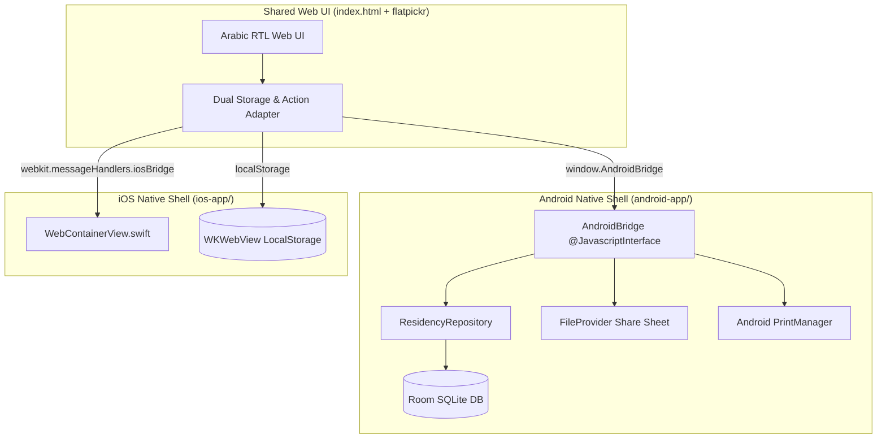

# ResidencyTracker Android APK Implementation Plan

> **For agentic workers:** REQUIRED SUB-SKILL: Use superpowers:subagent-driven-development (recommended) or superpowers:executing-plans to implement this plan task-by-task. Steps use checkbox (`- [ ]`) syntax for tracking.

**Goal:** Convert `ResidencyTracker` from an iOS-only `WKWebView + localStorage` app into a cross-platform repository that also builds a standalone Android `.apk` backed by a lightweight local **Room (SQLite)** database.

**Architecture:** An `android-app/` Gradle module hosts an Android `WebView` loading the shared offline web bundle (`assets/web/index.html`, CSS, JS) and exposes a `@JavascriptInterface` (`AndroidBridge`) backed by Room (`ResidencyDatabase`). On Android, `index.html` routes storage, file export (`FileProvider` + `Intent.ACTION_SEND`), and printing (`PrintManager`) through `window.AndroidBridge` while preserving `webkit.messageHandlers.iosBridge` and `localStorage` fallback for iOS.

**Architecture Diagram:**



**Tech Stack:** Kotlin 1.9+, Android Gradle Plugin 8.x, `minSdk 24` / `targetSdk 34`, AndroidX Room (`2.6.1`), `androidx.webkit`, JUnit4 + Robolectric / Room In-Memory Testing, GitHub Actions (`ubuntu-latest`).

**Spec:** Inspected from `ios-app/ResidencyTracker/App/WebContainerView.swift` and `ios-app/ResidencyTracker/Resources/Web/index.html`.

## Global Constraints
- 100% offline-first: no `INTERNET` permission required in `AndroidManifest.xml`.
- Zero personal data or hardcoded student records in default DB or assets.
- Shared web assets (`index.html`, `css/`, `js/`) must remain 100% compatible with iOS `WKWebView`.
- All Room DB operations from `AndroidBridge` run off the main UI thread or via synchronized DAO calls without blocking `WebView` rendering.
- Exported files must use `FileProvider` inside `cacheDir/exports/` with sanitized filenames (no path traversal).

## Review Focus
1. **Path traversal in `exportFile(filename, content)`**: A malicious or malformed `filename` like `../../prefs.xml` must be sanitized to its basename (`File(filename).name`) before writing to `cacheDir/exports/`.
2. **Corrupted JSON passed from JS to `saveRecordsJson` / `saveSettingsJson`**: Must catch `JSONException` / `IllegalArgumentException`, return `false` to JS, and never wipe existing Room rows.
3. **XSS / File access inside WebView**: `allowFileAccessFromFileURLs` and `allowUniversalAccessFromFileURLs` must be `false`; load via `WebViewAssetLoader` (`https://appassets.androidplatform.net/assets/web/index.html`) instead of `file://`.
4. **Configuration changes (rotation / dark mode)**: `MainActivity` must preserve `WebView` state or handle `configChanges="orientation|screenSize|uiMode"` cleanly without losing unsaved modal form inputs.
5. **Back button navigation**: Pressing Android Back while a modal (`editModal`) is open or `WebView` can go back should close/navigate gracefully instead of immediately exiting the app.

---

### Task 1: Android Project Scaffolding & Room Database Layer

**Files:**
- Create: `android-app/settings.gradle.kts`
- Create: `android-app/build.gradle.kts`
- Create: `android-app/app/build.gradle.kts`
- Create: `android-app/app/src/main/java/com/hussainali/residencytracker/data/TripEntity.kt`
- Create: `android-app/app/src/main/java/com/hussainali/residencytracker/data/SettingsEntity.kt`
- Create: `android-app/app/src/main/java/com/hussainali/residencytracker/data/ResidencyDao.kt`
- Create: `android-app/app/src/main/java/com/hussainali/residencytracker/data/ResidencyDatabase.kt`
- Test: `android-app/app/src/test/java/com/hussainali/residencytracker/data/ResidencyDaoTest.kt`

**Interfaces:**
- Produces:
  - `TripEntity(id: Long, exitDate: String, exitPage: String, entryDate: String, entryPage: String, days: Int, notes: String)`
  - `SettingsEntity(id: Int = 1, studentName: String, degreeName: String, department: String, country: String, targetDays: Int)`
  - `ResidencyDao`: `getAllTripsSorted(): List<TripEntity>`, `replaceAllTrips(trips: List<TripEntity>)`, `getSettings(): SettingsEntity?`, `upsertSettings(settings: SettingsEntity)`

- [ ] **Step 1: Write the failing Room DAO test**

```kotlin
@RunWith(RobolectricTestRunner::class)
class ResidencyDaoTest {
    private lateinit var db: ResidencyDatabase
    private lateinit var dao: ResidencyDao

    @Before fun setup() {
        val ctx = ApplicationProvider.getApplicationContext<Context>()
        db = Room.inMemoryDatabaseBuilder(ctx, ResidencyDatabase::class.java).allowMainThreadQueries().build()
        dao = db.residencyDao()
    }

    @After fun teardown() { db.close() }

    @Test fun replaceAllTrips_sortsByExitDateAndPreservesSettings() {
        dao.upsertSettings(SettingsEntity(1, "طالب تجريبي", "ماجستير", "CS", "UK", 180))
        dao.replaceAllTrips(listOf(
            TripEntity(2, "2026-02-01", "2", "2026-02-10", "2", 10, ""),
            TripEntity(1, "2026-01-01", "1", "2026-01-05", "1", 5, "first")
        ))
        val trips = dao.getAllTripsSorted()
        assertEquals(listOf("2026-01-01", "2026-02-01"), trips.map { it.exitDate })
        assertEquals("طالب تجريبي", dao.getSettings()?.studentName)
    }
}
```

- [ ] **Step 2: Run test to verify it fails**

Run: `cd android-app && ./gradlew testDebugUnitTest --tests "*.ResidencyDaoTest"`
Expected: FAIL with unresolved references (`ResidencyDatabase`, `ResidencyDao`, `TripEntity`, `SettingsEntity`).

- [ ] **Step 3: Create Gradle configuration & Room entities/DAO/database**

Scaffold `settings.gradle.kts`, `build.gradle.kts`, `app/build.gradle.kts` (with `room-runtime`, `room-ktx`, `ksp`, `androidx.webkit`, `robolectric`, `junit`), and implement `TripEntity`, `SettingsEntity`, `ResidencyDao` (`@Transaction fun replaceAllTrips` deleting and inserting), and `ResidencyDatabase`.

- [ ] **Step 4: Run test to verify it passes**

Run: `cd android-app && ./gradlew testDebugUnitTest --tests "*.ResidencyDaoTest"`
Expected: PASS (1 test passed).

- [ ] **Step 5: Commit**

```bash
git add android-app/
git commit -m "feat(android): add Gradle scaffold and Room SQLite database layer"
```

---

### Task 2: `AndroidBridge` (`@JavascriptInterface`) & Safe Export/Storage

**Files:**
- Create: `android-app/app/src/main/java/com/hussainali/residencytracker/bridge/AndroidBridge.kt`
- Test: `android-app/app/src/test/java/com/hussainali/residencytracker/bridge/AndroidBridgeTest.kt`

**Interfaces:**
- Consumes: `ResidencyDao`
- Produces:
  - `@JavascriptInterface fun getRecordsJson(): String`
  - `@JavascriptInterface fun saveRecordsJson(json: String): Boolean`
  - `@JavascriptInterface fun getSettingsJson(): String`
  - `@JavascriptInterface fun saveSettingsJson(json: String): Boolean`
  - `@JavascriptInterface fun exportFile(filename: String, content: String): Boolean`
  - `@JavascriptInterface fun printReport()`

- [ ] **Step 1: Write the failing `AndroidBridgeTest`**

```kotlin
@RunWith(RobolectricTestRunner::class)
class AndroidBridgeTest {
    @Test fun saveRecordsJson_rejectsMalformedJsonWithoutWipingDb() {
        // Seed 1 valid trip, call saveRecordsJson("{bad"), assert returns false and 1 trip remains
    }

    @Test fun exportFile_sanitizesPathTraversal() {
        // Call exportFile("../../evil.csv", "a,b"), assert written only inside cacheDir/exports/evil.csv
    }
}
```

- [ ] **Step 2: Run test to verify it fails**

Run: `cd android-app && ./gradlew testDebugUnitTest --tests "*.AndroidBridgeTest"`
Expected: FAIL with `Unresolved reference: AndroidBridge`.

- [ ] **Step 3: Implement `AndroidBridge.kt`**

Parse JSON arrays/objects using `org.json.JSONArray` / `org.json.JSONObject` (zero extra JSON library overhead), wrap writes in `try/catch (e: Exception)` returning `false` on malformed input, sanitize `exportFile` via `File(filename).name.ifBlank { "export.txt" }`, and invoke callbacks on `Activity.runOnUiThread` for `FileProvider` share sheet and `PrintManager`.

- [ ] **Step 4: Run test to verify it passes**

Run: `cd android-app && ./gradlew testDebugUnitTest --tests "*.AndroidBridgeTest"`
Expected: PASS.

- [ ] **Step 5: Commit**

```bash
git add android-app/app/src/main/java/.../bridge/AndroidBridge.kt android-app/app/src/test/.../AndroidBridgeTest.kt
git commit -m "feat(android): add AndroidBridge JS interface backed by Room"
```

---

### Task 3: `MainActivity`, `WebViewAssetLoader`, `FileProvider` & Dual Web Adapter

**Files:**
- Create: `android-app/app/src/main/AndroidManifest.xml`
- Create: `android-app/app/src/main/res/xml/file_paths.xml`
- Create: `android-app/app/src/main/java/com/hussainali/residencytracker/MainActivity.kt`
- Modify: `ios-app/ResidencyTracker/Resources/Web/index.html` (add `window.AndroidBridge` storage/export/print adapter alongside `iosBridge`)
- Sync: Copy `ios-app/ResidencyTracker/Resources/Web/*` into `android-app/app/src/main/assets/web/` (or reference via Gradle `sourceSets.main.assets.srcDirs`)

**Interfaces:**
- Consumes: `AndroidBridge`, `ResidencyDatabase`
- Produces: Launchable `MainActivity` hosting `WebViewAssetLoader` at `https://appassets.androidplatform.net/assets/web/index.html`.

- [ ] **Step 1: Write `MainActivity` smoke test (Robolectric)**

Verify `MainActivity` creates a `WebView` with `javaScriptEnabled = true`, `allowFileAccess = false`, and registers `"AndroidBridge"`.

- [ ] **Step 2: Run test to verify it fails**

Run: `cd android-app && ./gradlew testDebugUnitTest --tests "*.MainActivityTest"`
Expected: FAIL.

- [ ] **Step 3: Implement `MainActivity.kt`, `AndroidManifest.xml`, `file_paths.xml`, and dual JS adapter in `index.html`**

Point Gradle `assets.srcDirs` directly to `../../ios-app/ResidencyTracker/Resources/Web` so there is **one single source of truth** for the web UI (DRY!). In `index.html`:
- `init()` checks `window.AndroidBridge` first (`getRecordsJson()`, `getSettingsJson()`), falling back to `localStorage`.
- `saveToStorage()` writes to `window.AndroidBridge` when present, else `localStorage`.
- Export & print helpers dispatch to `window.AndroidBridge` when present, else `iosBridge` / `window.print()`.

- [ ] **Step 4: Run full Android unit test suite & assemble debug APK**

Run: `cd android-app && ./gradlew testDebugUnitTest assembleDebug`
Expected: `BUILD SUCCESSFUL` and `app-debug.apk` generated.

- [ ] **Step 5: Commit**

```bash
git add android-app/ ios-app/ResidencyTracker/Resources/Web/index.html
git commit -m "feat(android): add MainActivity WebView host and shared dual-bridge adapter"
```

---

### Task 4: GitHub Actions CI/CD for Android APK Releases

**Files:**
- Create: `.github/workflows/android-build.yml`

- [ ] **Step 1: Add `.github/workflows/android-build.yml`**

Configure `ubuntu-latest` with `actions/setup-java@v4` (JDK 17), `gradle/actions/setup-gradle@v3`, run `./gradlew testDebugUnitTest assembleRelease` (or signed/unsigned APK), upload `ResidencyTracker-Android.apk` as an artifact, and attach it to the GitHub Release on `refs/tags/v*` via `softprops/action-gh-release@v2`.

- [ ] **Step 2: Validate workflow YAML & push**

Verify `android-build.yml` syntax, commit, and push to trigger CI build verification.
